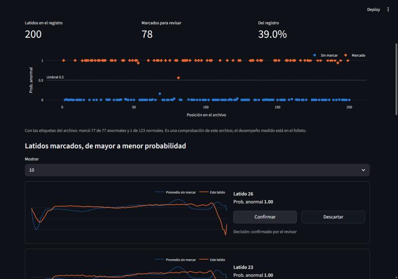
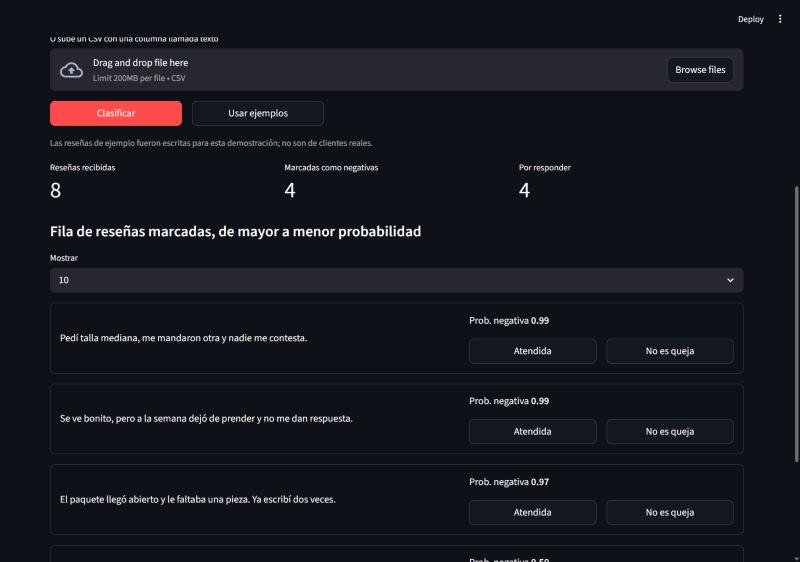

# Aprendizaje Automático 3 · Examen P2 · Equipo N1

**Equipo:** León Franco Fernando, Mendoza Rodriguez Rodrigo, Muñoz Delgado Gael Arturo

Este repositorio contiene dos proyectos de clasificación. Ambos se desarrollaron en Google Colab con GPU T4 y se evaluaron en la prueba del cliente con umbral de 0.5.

| Proyecto | Cliente | Tarea | Modelo elegido | Resultado en prueba |
|---|---|---|---|---|
| [`ecg/`](ecg/) | CardioRitmo | Detectar latidos anormales | Conv1D | Cumple |
| [`resenas/`](resenas/) | Compra Fácil Bajío | Detectar reseñas negativas | BETO ajustado | Cumple |

## Video

**[Ver el video en YouTube: dos clientes, un método (1:43)](https://youtu.be/kxrpZ-PDz_c)**

También está en este repositorio: [`video/examen_p2_dos_clientes.mp4`](video/examen_p2_dos_clientes.mp4).

Cuenta los dos proyectos como una propuesta para cada cliente: el problema, los modelos que comparamos, la elección con validación, la prueba abierta una sola vez y los límites de cada modelo. Las cifras salen de los cuadernos y de los resultados de este repositorio. No tiene narración: el texto va en pantalla.

## Modelo de reseñas

El modelo BETO pesa 420 MB y supera el límite de 100 MB por archivo de GitHub, por lo que `model.safetensors` se publica aparte:

**[Descargar la carpeta del modelo desde Google Drive](https://drive.google.com/drive/folders/1kN9eWLKd9fQhWvdKGPZ7JwqujOL6fKuw?usp=sharing)**

Para usarlo, coloca los archivos descargados en `resenas/modelo/modelo_resenas_beto/`. Esa carpeta debe quedar con `config.json`, `model.safetensors`, `tokenizer.json` y `tokenizer_config.json`. Después se carga con `from_pretrained`:

```python
from transformers import AutoModelForSequenceClassification, AutoTokenizer

ruta = "resenas/modelo/modelo_resenas_beto"
tokenizador = AutoTokenizer.from_pretrained(ruta)
modelo = AutoModelForSequenceClassification.from_pretrained(ruta)
```

En este modelo, la clase 1 significa reseña **negativa**.

## CardioRitmo: tamizaje de latidos (`ecg/`)

**Datos:** ECG5000 del archivo UCR, con 4,998 latidos de 140 puntos de un solo paciente (BIDMC, PhysioNet).

**Especificación del cliente:** sensibilidad y especificidad de al menos 95 %, con un máximo de 20,000 parámetros.

| Modelo | Tipo | Parámetros | Sensibilidad | Especificidad | AUC | Cumple |
|---|---|---:|---:|---:|---:|---|
| Línea base (todo normal) | línea base | 0 | 0.0 % | 100.0 % | 0.5000 | No |
| **Conv1D (elegido)** | convolucional | 5,857 | 99.3 % | 99.5 % | 0.9986 | Sí |
| TCN | convolucional | 14,593 | 98.8 % | 99.5 % | 0.9990 | Sí |
| Bi-GRU | recurrente | 6,785 | 99.0 % | 99.8 % | 0.9988 | Sí |

**Limitación principal:** todos los latidos vienen de una sola persona, así que no hay evidencia de que el modelo funcione con otros pacientes. Es una herramienta de apoyo para priorizar la revisión, no un diagnóstico.

## Compra Fácil Bajío: reseñas negativas (`resenas/`)

**Datos:** [SetFit/amazon_reviews_multi_es](https://huggingface.co/datasets/SetFit/amazon_reviews_multi_es), reseñas de Amazon en español (Keung et al., 2020).

**Especificación del cliente:** exhaustividad de al menos 90 % y precisión de al menos 85 %, con un modelo propio, sin LLM por API.

| Modelo | Tipo | Parámetros | Exhaustividad | Precisión | Exactitud | Cumple |
|---|---|---:|---:|---:|---:|---|
| Línea base (todo negativa) | línea base | 0 | 100.0 % | 50.0 % | 50.0 % | No |
| TF-IDF + red densa | conjunto | 960,065 | 88.4 % | 92.8 % | 90.8 % | No |
| Embedding + Bi-LSTM | recurrente | 1,304,897 | 88.4 % | 89.3 % | 88.9 % | No |
| **BETO ajustado (elegido)** | transformer | 109,852,418 | 95.3 % | 92.5 % | 93.8 % | Sí |

**Limitaciones principales:** los datos son de Amazon España y el cliente es mexicano. El modelo no detectó ninguna de las 4 frases sarcásticas probadas. Además, la precisión baja cuando las reseñas negativas son menos frecuentes que en la prueba.

## PMV: app web local (`pmv/`)

Una app de Streamlit con una pestaña por cliente. Clasifica con los modelos guardados en `modelo/` y el umbral de 0.5, y corre en CPU.

- **CardioRitmo:** usa 200 latidos de ejemplo o un CSV de 140 puntos por latido, y muestra los marcados de mayor a menor probabilidad, con su trazo.
- **Compra Fácil Bajío:** recibe reseñas escritas o en CSV, y arma la fila de atención con las marcadas como negativas.

| CardioRitmo | Compra Fácil Bajío |
|---|---|
|  |  |

Para correrla desde la raíz del repositorio:

1. Descarga `model.safetensors` de la [carpeta de Drive](https://drive.google.com/drive/folders/1kN9eWLKd9fQhWvdKGPZ7JwqujOL6fKuw?usp=sharing) y colócalo en `resenas/modelo/modelo_resenas_beto/`. Sin ese archivo, la pestaña de latidos funciona y la de reseñas muestra este mismo enlace.
2. Instala las dependencias y abre la app:

```bash
pip install -r pmv/requirements.txt
```

```bash
streamlit run pmv/app.py
```

Comprobamos que la app usa los mismos modelos: con el código de `pmv/modelos.py`, el modelo de latidos reproduce los resultados de `resultados_ecg.csv` y BETO reproduce las probabilidades de las 16 frases de prueba, con una diferencia máxima de 0.0005.

**Límites:** es una demostración local. Los botones de decisión solo duran la sesión, y no se guarda ni se envía nada. Los latidos de ejemplo son de la prueba del cliente, salen del mismo paciente y no son consecutivos, por lo que no equivalen a un registro de 24 horas. Las limitaciones de cada modelo siguen siendo las descritas arriba.

## Estructura del repositorio

```text
ecg/
├── DEV_ecg.ipynb            Cuaderno de desarrollo, con salidas
├── folleto_ecg.pdf          Folleto para el cliente
├── modelo/                  Modelo elegido (modelo_ecg.keras)
├── resultados_ecg.csv       Resultados en la prueba del cliente
└── entrega_ecg.zip          Paquete de entrega
resenas/
├── DEV_resenas.ipynb        Cuaderno de desarrollo, con salidas
├── folleto_resenas.pdf      Folleto para el cliente
├── modelo/                  modelo_resenas_beto/: configuración y tokenizador (los pesos están en Drive)
├── resultados_resenas.csv   Resultados en la prueba del cliente
└── entrega_resenas.zip      Paquete de entrega
pmv/
├── app.py                   Interfaz de Streamlit
├── modelos.py               Carga de los modelos e inferencia
├── generar_ejemplos.py      Crea datos/latidos_ejemplo.csv
├── requirements.txt         Dependencias de la app
├── datos/                   Latidos de ejemplo
└── capturas/                Capturas de la app
video/
└── examen_p2_dos_clientes.mp4  Video que explica los dos proyectos
```

## Reproducir los resultados

Abre `DEV_ecg.ipynb` o `DEV_resenas.ipynb` en Google Colab, activa la GPU T4 y ejecuta las celdas en orden. Los datos se descargan desde los propios cuadernos.
